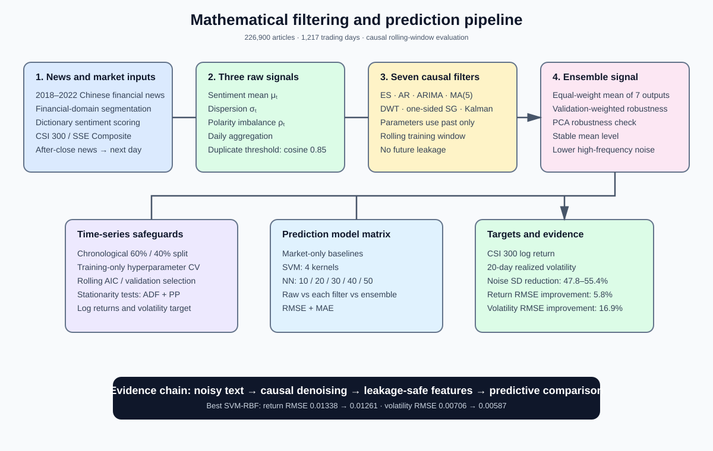

# Mathematical Filtering for Chinese Financial News Sentiment

## 论文展示

**A Mathematical Filtering and Prediction Framework for Chinese Financial News Sentiment Signals**

- Authors: Shu Wu, Lina Zhang, Rende Li
- Venue: *Mathematics*, 14(13), 2246 (published 23 June 2026)
- DOI: [10.3390/math14132246](https://doi.org/10.3390/math14132246)


## 一句话概括

论文将中文财经新闻的日度情绪均值、离散度和极性不平衡构成三维信号，经七种因果滤波器分别处理，再做透明的等权集成，比较原始/滤波情绪对 CSI 300 收益与实现波动率的预测价值。

## 框架设计图



图中突出“新闻文本—三维信号—七路因果滤波—集成—时间序列预测”的流水线，以及防止未来信息泄漏的关键控制点。

## 工程特色

### 1. 三维情绪信号

对每天的文章级情绪分数聚合为：

- **Sentiment mean**：新闻总体乐观/悲观程度；
- **Sentiment dispersion**：新闻之间的意见分歧/异质性；
- **Polarity imbalance**：正负情绪强度的不对称性。

文章使用金融领域中文分词和可解释的词典法打分，避免依赖不可公开的模型权重或私有微调语料。

### 2. 七路滤波 + 等权集成

每个情绪维度独立经过：

1. Exponential smoothing
2. Autoregressive filtering
3. ARIMA filtering
4. Five-day moving average
5. Discrete wavelet transform
6. One-sided causal Savitzky–Golay
7. Kalman filtering

七个输出等权平均形成最终信号。等权方案是透明基准，可避免在有限样本上额外估计组合权重；论文还以验证误差加权和 PCA 第一主成分做稳健性比较。

### 3. 明确防止 look-ahead bias

- 所有参数选择都限制在截至预测时点的 rolling training window。
- AR/ARIMA 用窗口内 AIC 选阶；DWT 用窗口内一步预测误差选分解层级。
- Savitzky–Golay 使用单侧因果窗口，不使用标准居中的未来观测。
- Kalman 的 `Q`、`R` 只用历史窗口估计，并从窗口起点递归到当前时点。
- 新闻收盘后 15:00（北京时间）发布的内容归入下一个交易日。
- 最终预测采用按时间顺序的 60% train / 40% test，测试集不参与调参。

### 4. 市场预测接口

滤波后的情绪特征输入两类预测器：

- SVM：linear、polynomial、RBF、sigmoid 四种核；
- Neural network：隐藏神经元数 10、20、30、40、50。

目标变量是 CSI 300 / SSE Composite 日对数收益和 20 个交易日窗口的 realized volatility；评估使用 RMSE 和 MAE。

## 实验设计

### 数据构建

| 项目 | 设计 |
|---|---|
| 时间范围 | 2018-01-02 至 2022-12-31 |
| 时间单位 | 1,217 个交易日 |
| 新闻量 | 清洗去重后约 226,900 篇，日均 186.42 篇 |
| 来源 | 上交所/深交所公告、中国证券报、上海证券报、证券时报及主要财经门户 |
| 去重 | 标题与正文相似度，cosine similarity threshold = 0.85 |
| 市场数据 | Wind 的 CSI 300 与 SSE Composite 收盘价 |
| 波动率 | 20 日滚动窗口的日对数收益偏差平方均值（不取平方根） |

样本覆盖 2018 年贸易摩擦、2019 年市场修复、2020 年疫情冲击、2021 年监管收紧和 2022 年市场调整等不同市场状态。

### 对照与评估矩阵

实验按以下顺序验证：

1. 与 historical mean、random walk、AR、ARIMA、HAR-RV 等不使用情绪的市场基线比较；
2. 比较原始情绪、七种单独滤波和等权集成；
3. 在 SVM 的四种核下重复 raw/filtered 对比；
4. 在五种神经网络规模下重复 raw/filtered 对比；
5. 比较等权、验证误差加权和 PCA 集成；
6. 通过不同过滤器的结果和模型规模检查组件贡献。

### 主要结果

#### 去噪效果

| 情绪维度 | Raw SD | Filtered SD | SD 降幅 |
|---|---:|---:|---:|
| Sentiment mean | 0.184 | 0.096 | 47.8% |
| Sentiment dispersion | 0.092 | 0.041 | 55.4% |
| Polarity imbalance | 0.236 | 0.118 | 50.0% |

均值水平基本保持稳定，说明集成的主要作用是抑制短期波动，而非改变信号中心。

#### SVM-RBF 预测

| 任务 | Raw RMSE | Filtered RMSE | 改善 |
|---|---:|---:|---:|
| CSI 300 log return | 0.01338 | 0.01261 | 5.8% |
| Realized volatility | 0.00706 | 0.00587 | 16.9% |

滤波情绪在所有 SVM 核配置下均优于原始情绪；收益预测的改善小于波动率预测，符合“滤波更擅长抽取稳定风险状态”的解释。

#### 神经网络

20 个隐藏神经元在收益和波动率任务上均取得最佳测试表现：

- 收益：filtered test RMSE = 0.01278，raw = 0.01349；
- 波动率：filtered test RMSE = 0.00594，raw = 0.00718。

#### 集成稳健性

验证误差加权略优于等权，但差异很小；PCA 第一主成分略差。等权方案因此在性能接近的情况下保留了最好的可解释性和复现性。


## 引用

```text
Wu, S., Zhang, L., & Li, R. (2026). A Mathematical Filtering and Prediction
Framework for Chinese Financial News Sentiment Signals. Mathematics, 14(13), 2246.
https://doi.org/10.3390/math14132246
```
